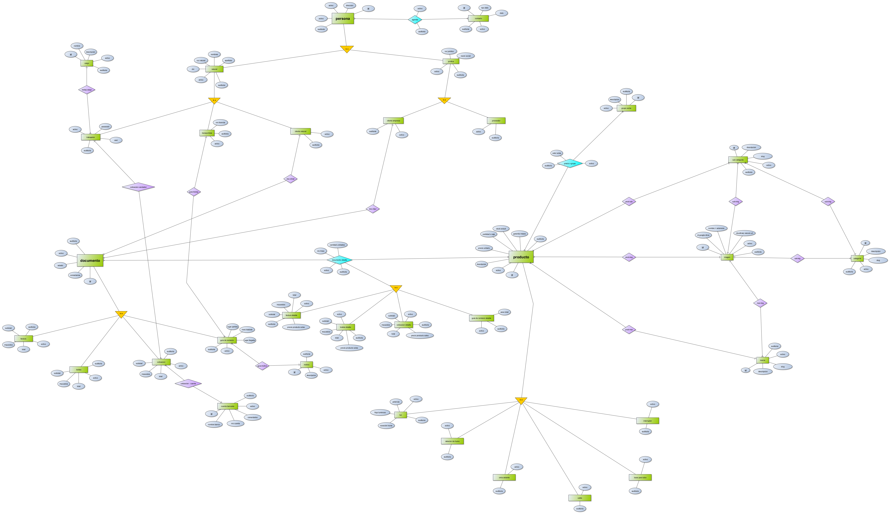
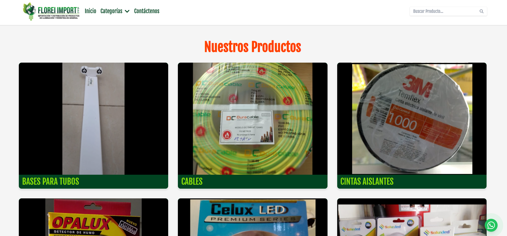
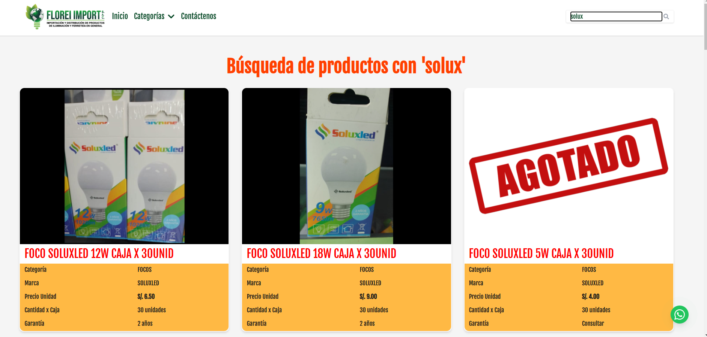
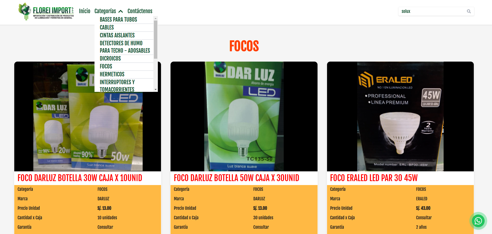
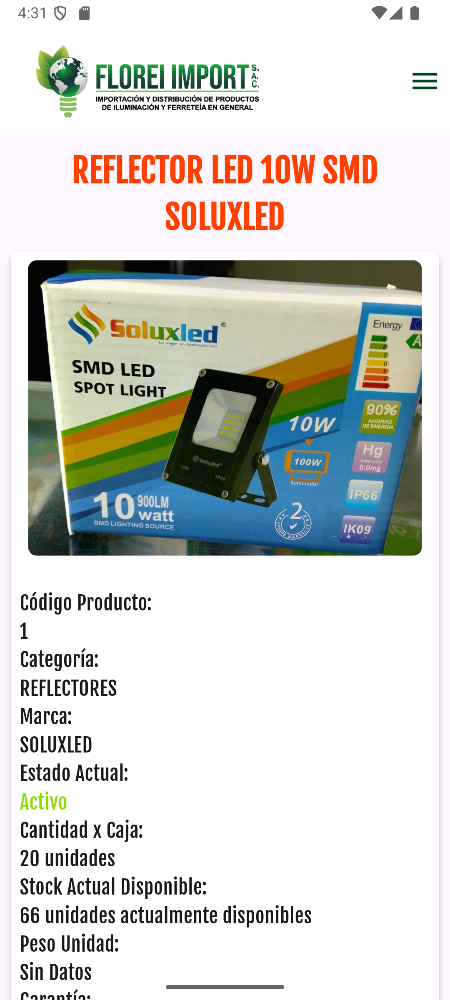
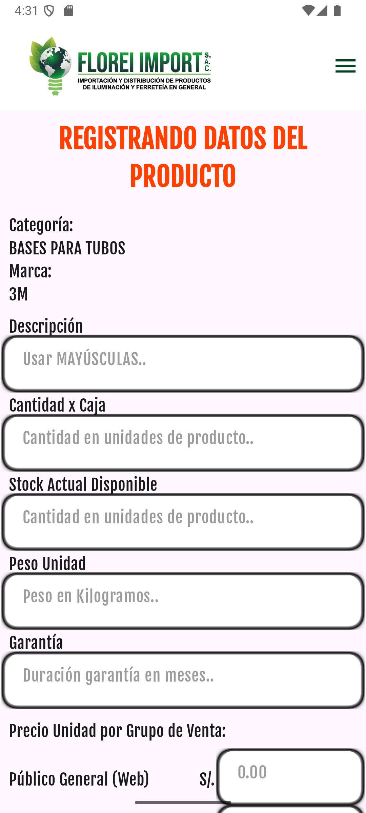

# Florei Import

Sistema informático de gestión de productos para una distribuidora y comercial de luminarias LED. Manejo de bases de datos PostgreSQL. Backend: Servicio REST basado en Spring MVC Framework y JPA Hibernate. Frontend: Aplicación web desarrollada en React JS y Tailwind CSS que consume datos del API REST. Móvil: Aplicación desarrollada en Flutter que consume datos del API REST, y actualiza la información mostrada en la aplicación web. Manejo de imágenes a través de la plataforma Cloudinary.

# Cómo ejecutarlo

Ejecute los comandos siguientes desde PowerShell. Inicie primero la API y luego la aplicación web o móvil.

## Requisitos

- PostgreSQL, con una base de datos llamada `florei` y las tablas del proyecto.
- JDK 8 o una versión compatible con el proyecto.
- Node.js y npm.
- Flutter SDK compatible con Dart `^3.6.0`.
- Android Studio o un dispositivo/emulador Android para ejecutar la aplicación móvil.

## API (`/api`)

Configure PostgreSQL con el usuario y la contraseña usados por `application.properties`. Si la base de datos todavía no existe:

```powershell
psql -U postgres -c "CREATE DATABASE florei;"
```

Desde la raíz del proyecto:

```powershell
Set-Location .\api
@'
spring.jpa.hibernate.naming.physical-strategy=org.hibernate.boot.model.naming.PhysicalNamingStrategyStandardImpl
spring.jpa.properties.hibernate.show_sql=true
spring.jpa.properties.hibernate.format_sql=true
spring.jpa.properties.hibernate.jdbc.time_zone=UTC
spring.jpa.hibernate.ddl-auto=none
spring.datasource.url=jdbc:postgresql://localhost:5432/florei?password=postgres&user=postgres
'@ | Set-Content -Encoding utf8 .\src\main\resources\application.properties

.\mvnw.cmd spring-boot:run
```

La API queda disponible en `http://localhost:8080`. Ajuste la URL de `spring.datasource.url` si su usuario, contraseña, puerto o nombre de base de datos son diferentes. No use `create` en `spring.jpa.hibernate.ddl-auto`; el proyecto espera que el esquema ya exista.

Para crear el paquete sin iniciar el servidor:

```powershell
Set-Location .\api
.\mvnw.cmd clean package
```

## Aplicación web (`/web`)

En otra ventana de PowerShell:

```powershell
Set-Location .\web
npm install
@'
VITE_URL_API=http://localhost:8080/
VITE_TITLE_SUFFIX=Florei Import SAC
VITE_FOOTER_TELEFONOS=000000000
VITE_FLOREI_DIR=Dirección de la empresa
VITE_URL_GDRIVE=https://drive.google.com/uc?id=
VITE_TRANSFORM_CLOUDINARY=c_fill,w_800/
VITE_SINDATOS=Sin datos
'@ | Set-Content -Encoding utf8 .\.env
npm run dev
```

Vite mostrará la dirección local, normalmente `http://localhost:5173`. Reemplace los valores de ejemplo por los datos reales del sitio y conserve `/` al final de `VITE_URL_API`.

Para verificar una compilación de producción:

```powershell
Set-Location .\web
npm run build
npm run preview
```

## Aplicación móvil (`/mobile`)

Instale las dependencias y cree el archivo local que define la dirección de la API:

```powershell
Set-Location .\mobile
flutter doctor
flutter pub get
New-Item -ItemType Directory -Force .\lib\global | Out-Null
@'
const String urlApi = "http://localhost:8080/";
'@ | Set-Content -Encoding utf8 .\lib\global\config.dart
flutter run -d windows
```

Para una aplicación Android, utilice `10.0.2.2` cuando el emulador acceda al API ejecutándose en el mismo equipo Windows:

```powershell
Set-Location .\mobile
@'
const String urlApi = "http://10.0.2.2:8080/";
'@ | Set-Content -Encoding utf8 .\lib\global\config.dart
flutter run -d <id-dispositivo>
```

Para ver los dispositivos disponibles:

```powershell
flutter devices
```

Reemplace `<id-dispositivo>` por uno de los identificadores mostrados por `flutter devices`. En un teléfono físico, use la dirección IPv4 del equipo Windows, por ejemplo `http://192.168.1.50:8080/`, y permita las conexiones entrantes al puerto `8080` en el firewall de Windows.


# Screenshots















