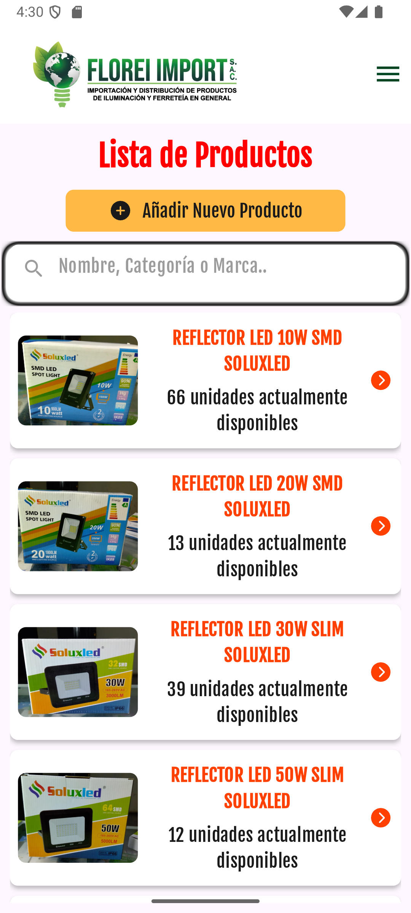
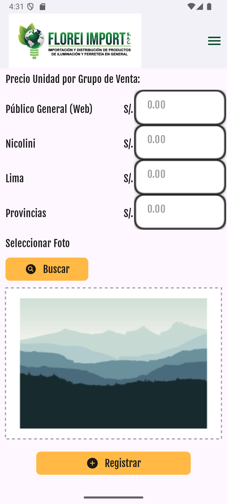
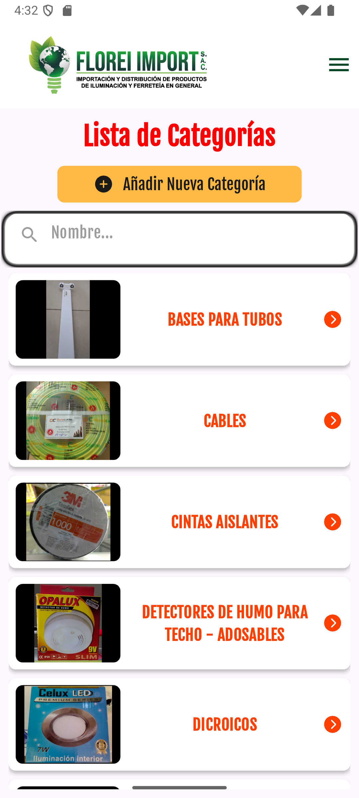
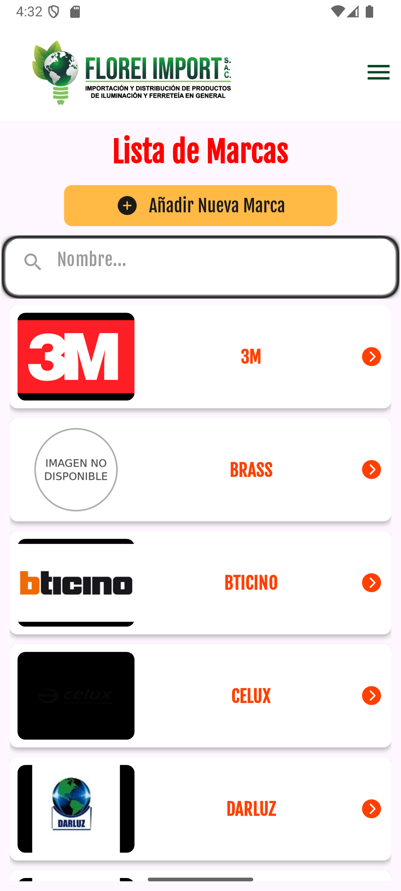
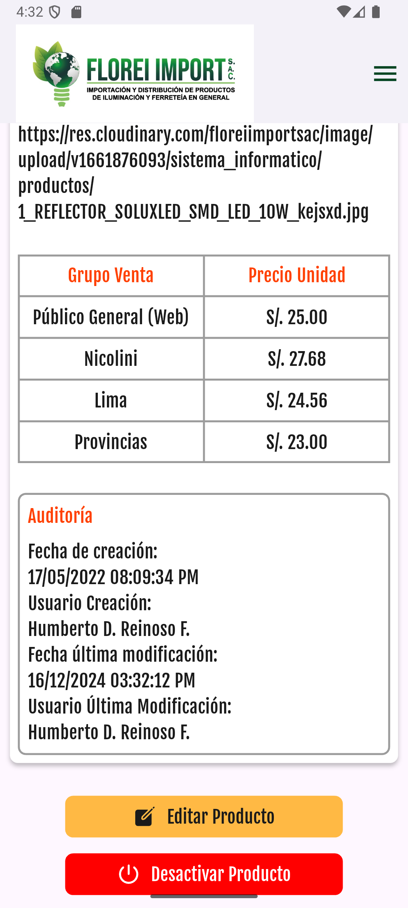

# Florei Import

Sistema informático de gestión de productos para una distribuidora y comercial de luminarias LED. Manejo de bases de datos PostgreSQL. Backend: Servicio REST basado en Spring MVC Framework y JPA Hibernate. Frontend: Aplicación web desarrollada en React JS y Tailwind CSS que consume datos del API REST. Móvil: Aplicación desarrollada en Flutter que consume datos del API REST, y actualiza la información mostrada en la aplicación web. Manejo de imágenes a través de la plataforma Cloudinary.

# Cómo ejecutarlo

## /web

## /mobile

## /api

# Screenshots

